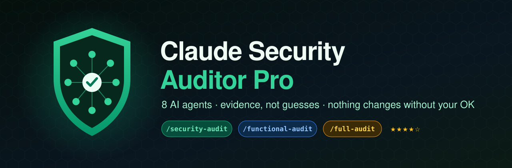
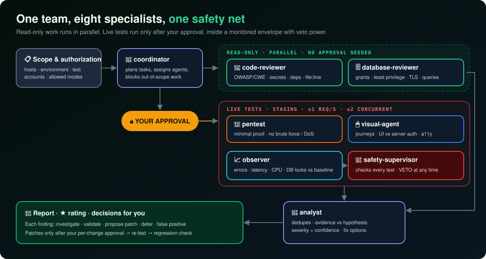
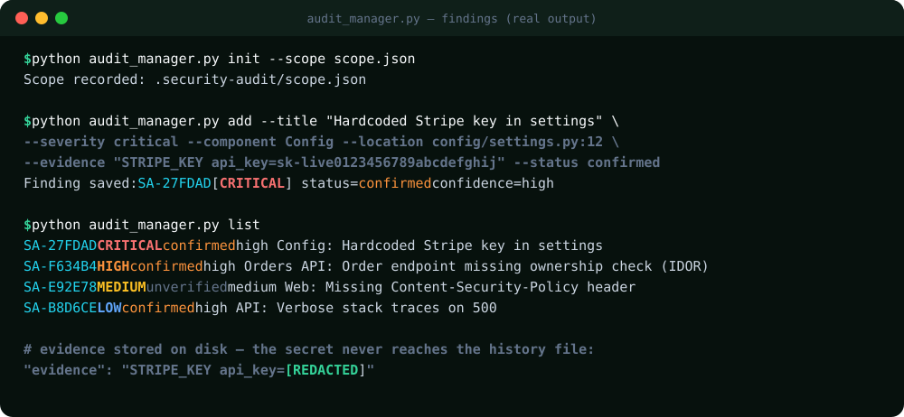
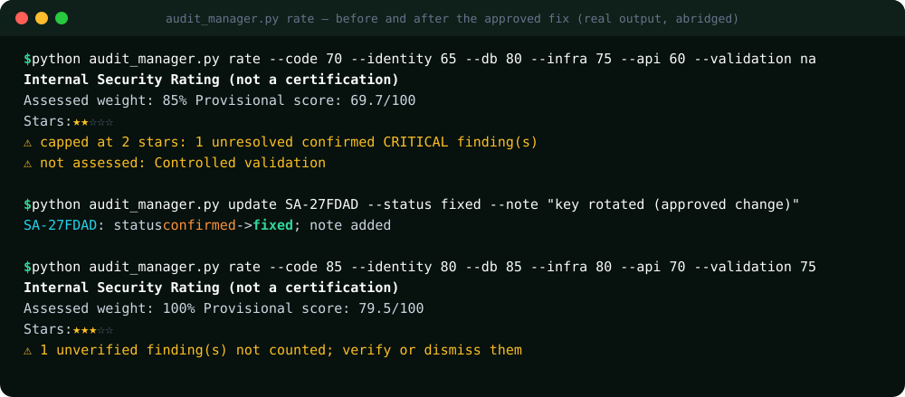

<p align="center">
  
</p>

<p align="center">
  <a href="https://github.com/jorgevb27/claude-security-auditor-pro/stargazers"></a>
  <a href="https://github.com/jorgevb27/claude-security-auditor-pro/releases"></a>
  <a href="https://github.com/jorgevb27/claude-security-auditor-pro/actions/workflows/test.yml"></a>
  
  
  
  <a href="LICENSE"></a>
</p>

<p align="center">
  <a href="README.md">English</a> · <b>Español</b> · <a href="docs/MANUAL.es.md"><b>📗 Manual completo</b></a> · <a href="docs/MANUAL.en.md">📘 English manual</a>
</p>

---

**Un equipo de seguridad dentro de Claude Code.** Ocho agentes especializados auditan **tu propia aplicación, con autorización**:
código fuente, secretos, dependencias, autenticación, APIs, base de datos, TLS y los recorridos reales de usuario en el navegador.
Cada hallazgo viene con evidencia. No se cambia nada hasta que lo aprobás, y un supervisor de seguridad puede frenar cualquier prueba en cualquier momento.

```
/security-audit     → código, secretos, dependencias, auth, APIs, base de datos, TLS/config
/functional-audit   → recorridos de usuario, autorización UI vs servidor, accesibilidad, regresiones
/full-audit         → ambas, correlacionadas, más una calificación ★ interna
```

<p align="center">
  
</p>

## ✨ Qué la hace distinta

| | "Escaneo de seguridad con IA" típico | **Claude Security Auditor Pro** |
|---|---|---|
| Empieza por | Disparar requests | **Alcance y autorización**: hosts, entorno, cuentas de prueba |
| Hallazgos | "Posible vulnerabilidad" | Evidencia · `archivo:línea` · severidad · **confianza** · opciones de arreglo |
| Pruebas en vivo | Sin límites | Staging primero, **≤1 req/s**, con aprobación, observador y **veto** |
| Arreglos | Se aplican solos | **Aprobación por cada cambio**, después se vuelve a probar |
| Herramientas faltantes | Se simulan en silencio | Se informan como **huecos de cobertura**, nunca se inventan |
| Puntaje | "100 % seguro ✅" | Calificación ★ interna con **reglas de cobertura** y topes por severidad |
| Secretos | Terminan en los logs | Se **enmascaran** antes de guardar nada |

## 🖥️ Capturas

**Hallazgos con severidad, estado y confianza. La clave filtrada se enmascara antes de llegar al disco:**

<p align="center"></p>

**Una calificación honesta: un crítico confirmado la limita a ★★. Lo arreglás (con aprobación) y se recalcula:**

<p align="center"></p>

## 🚀 Instalación

### Opción A: plugin de Claude Code (recomendada)

```
/plugin marketplace add jorgevb27/claude-security-auditor-pro
/plugin install claude-security-auditor-pro@claude-security-auditor-pro
```

En los plugins, las skills llevan prefijo: `/claude-security-auditor-pro:full-audit`. También podés pedirlo directamente: *"Hacé una auditoría completa de este proyecto"*.

### Opción B: copiar a tu proyecto

```bash
git clone --depth 1 https://github.com/jorgevb27/claude-security-auditor-pro /tmp/csap
mkdir -p .claude/skills .claude/agents
cp -r /tmp/csap/skills/* .claude/skills/
cp /tmp/csap/agents/*.md .claude/agents/
echo ".security-audit/" >> .gitignore
```

<details><summary>Windows (PowerShell)</summary>

```powershell
git clone --depth 1 https://github.com/jorgevb27/claude-security-auditor-pro $env:TEMP\csap
New-Item -ItemType Directory -Force .claude\skills, .claude\agents | Out-Null
Copy-Item -Recurse $env:TEMP\csap\skills\* .claude\skills\
Copy-Item $env:TEMP\csap\agents\*.md .claude\agents\
Add-Content .gitignore ".security-audit/"
```
</details>

No se copia nada en tu carpeta `docs/` ni en la raíz del proyecto, y lo que ya tengas personalizado en `.claude/` se conserva.

### Opción C: Claude.ai

Descargá `claude-security-auditor-pro-skill.zip` de la [última release](https://github.com/jorgevb27/claude-security-auditor-pro/releases/latest)
→ **Configuración → Capacidades → Skills → Subir skill**. (Los subagentes son de Claude Code; en Claude.ai el mismo procedimiento corre en una sola conversación.)

## 🕹️ Inicio rápido

1. Abrí tu proyecto en Claude Code y ejecutá **`/full-audit`**.
2. Claude te pide el **alcance**: entorno (preferentemente staging), hosts autorizados, cuentas de prueba y modos permitidos. Lo guarda en `.security-audit/scope.json`.
3. Primero corre la revisión de solo lectura. Las pruebas en vivo empiezan **recién cuando las aprobás**.
4. Recibís cada hallazgo con evidencia y opciones: *investigar · validar · proponer parche · posponer · falso positivo*.
5. Aprobás los arreglos uno por uno → Claude vuelve a probar → **calificación + informe en Markdown**.

👉 Paso a paso con capturas: **[docs/MANUAL.es.md](docs/MANUAL.es.md)**

## ⭐ Calificación interna

| Dimensión | Peso | | Regla |
|---|---|---|---|
| Código | 20 % | | Cobertura < 80 % → **sin estrellas** |
| Identidad / auth | 20 % | | CRÍTICO confirmado sin resolver → máximo ★★ |
| Base de datos | 15 % | | ALTO confirmado sin resolver → máximo ★★★ |
| Infraestructura / TLS | 15 % | | ★★★★★ requiere ≥ 95 % de cobertura y evidencia reciente |
| APIs | 15 % | | Lo que no se probó no cuenta como perfecto: se excluye y se informa |
| Validación controlada | 15 % | | |

> La calificación sirve para **priorizar**. No es una certificación ni una prueba de que el sistema sea seguro.

## 🛡️ Política de seguridad (la cumplen todos los agentes)

- ✅ Solo sistemas tuyos o que estés autorizado a probar, dentro de un alcance registrado.
- ✅ Solo lectura por defecto; preferentemente staging y datos sintéticos.
- 🚫 Nada de fuerza bruta, credential stuffing, password spraying, DoS, evasión, persistencia, exfiltración, SQL destructivo, fuzzing sin control ni saltear CAPTCHA.
- 🛑 Se frena solo ante picos de errores 5xx, latencia > 2× la base, presión de recursos, contención en la base de datos o escrituras inesperadas.
- 🔐 Secretos y datos personales enmascarados. `.security-audit/` queda fuera de Git.

Texto completo: [POLICY.md](skills/security-auditor-pro/references/POLICY.md) · [OPERATIONS.md](skills/security-auditor-pro/references/OPERATIONS.md)

## 🗂️ Contenido

```
skills/
├── security-auditor-pro/      procedimiento central + kit
│   ├── references/            POLICY · OPERATIONS · RATING · REPORT_TEMPLATE · scope.example.json
│   └── scripts/audit_manager.py   hallazgos / calificación / informe (solo librería estándar, sin red)
├── security-audit/            entrada: modo seguridad
├── functional-audit/          entrada: modo funcional y visual
└── full-audit/                entrada: ambos + calificación
agents/                        coordinator · code-reviewer · database-reviewer · pentest
                               visual-agent · observer · analyst · safety-supervisor
tests/                         11 tests unitarios (CI en cada push)
```

**Herramientas opcionales** que usa si las tenés instaladas: Semgrep, Gitleaks, Trivy, OWASP ZAP (acotado), testssl.sh y Playwright MCP.

## 🤝 Contribuir

Se aceptan PRs: chequeos nuevos por stack (Django, Rails, Laravel, Next.js…), formatos de informe y traducciones.
Lo único que pedimos es mantener intacta la política de seguridad. Si te ayudó a encontrar un bug real antes que un atacante, **una ⭐ ayuda a que otros la encuentren.**

## 📄 Licencia

[MIT](LICENSE) © jorgevb27. Usala solo en sistemas que estés autorizado a probar.
