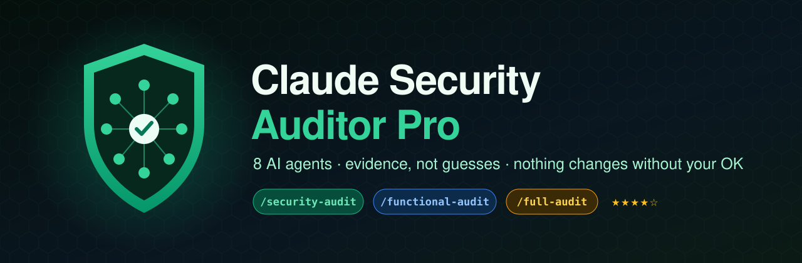
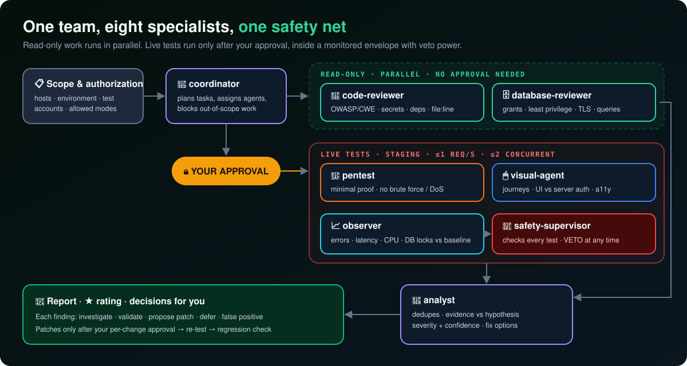
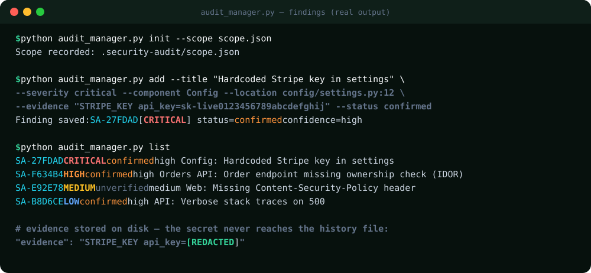
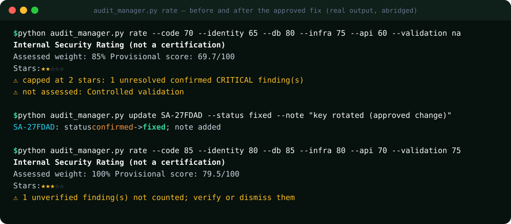

<p align="center">
  
</p>

<p align="center">
  <a href="https://github.com/jorgevb27/claude-security-auditor-pro/stargazers"></a>
  <a href="https://github.com/jorgevb27/claude-security-auditor-pro/releases"></a>
  <a href="https://github.com/jorgevb27/claude-security-auditor-pro/actions/workflows/test.yml"></a>
  
  
  
  <a href="LICENSE"></a>
</p>

<p align="center">
  <b>English</b> · <a href="README.es.md">Español</a> · <a href="docs/MANUAL.en.md"><b>📘 Full manual</b></a> · <a href="docs/MANUAL.es.md">📗 Manual en español</a>
</p>

---

**A security team inside Claude Code.** Eight specialized agents audit **your own, authorized** application:
source code, secrets, dependencies, authentication, APIs, database, TLS and real user journeys in the browser.
Every finding comes with evidence. Nothing gets changed until you approve it, and a safety supervisor can stop any test at any time.

```
/security-audit     → code, secrets, deps, auth, APIs, DB, TLS/config
/functional-audit   → user journeys, UI vs server authorization, a11y, regressions
/full-audit         → both, correlated, plus an internal ★ rating
```

<p align="center">
  
</p>

## ✨ Why it's different

| | Typical "AI security scan" | **Claude Security Auditor Pro** |
|---|---|---|
| Starts with | Firing requests | **Scope & authorization**: hosts, environment, test accounts |
| Findings | "Possible vulnerability" | Evidence · `file:line` · severity · **confidence** · fix options |
| Live testing | Unbounded | Staging-first, **≤1 req/s**, approval required, observer + **veto** |
| Fixes | Applied automatically | **Per-change approval**, then re-test and regression check |
| Missing tools | Silently simulated | Reported as **coverage gaps**, never faked |
| Score | "100% secure ✅" | Internal ★ rating with **coverage rules** and severity caps |
| Secrets | End up in logs | **Redacted** before anything is written |

## 🖥️ Screenshots

**Findings with severity, status and confidence. The leaked key is redacted before it ever touches disk:**

<p align="center"></p>

**An honest rating: a confirmed critical caps it at ★★. Fix it (with approval) and re-rate:**

<p align="center"></p>

## 🚀 Install

### Option A: Claude Code plugin (recommended)

```
/plugin marketplace add jorgevb27/claude-security-auditor-pro
/plugin install claude-security-auditor-pro@claude-security-auditor-pro
```

Plugin skills are namespaced: `/claude-security-auditor-pro:full-audit`. Or simply ask: *"Run a full audit of this project"*.

### Option B: copy into your project

```bash
git clone --depth 1 https://github.com/jorgevb27/claude-security-auditor-pro /tmp/csap
mkdir -p .claude/skills .claude/agents
cp -r /tmp/csap/skills/* .claude/skills/
cp /tmp/csap/agents/*.md .claude/agents/
echo ".security-audit/" >> .gitignore
```

<details><summary>Windows (PowerShell)</summary>

```powershell
git clone --depth 1 https://github.com/jorgevb27/claude-security-auditor-pro $env:TEMP\csap
New-Item -ItemType Directory -Force .claude\skills, .claude\agents | Out-Null
Copy-Item -Recurse $env:TEMP\csap\skills\* .claude\skills\
Copy-Item $env:TEMP\csap\agents\*.md .claude\agents\
Add-Content .gitignore ".security-audit/"
```
</details>

Nothing is copied into your `docs/` or project root, and your existing `.claude/` customizations are kept.

### Option C: Claude.ai

Download `claude-security-auditor-pro-skill.zip` from the [latest release](https://github.com/jorgevb27/claude-security-auditor-pro/releases/latest)
→ **Settings → Capabilities → Skills → Upload skill**. (Sub-agents are a Claude Code feature; on Claude.ai, the same procedure runs in one conversation.)

## 🕹️ Quick start

1. Open your project in Claude Code and run **`/full-audit`**.
2. Claude asks for the **scope**: environment (staging preferred), authorized hosts, test accounts, allowed modes. It records it in `.security-audit/scope.json`.
3. Read-only review runs first. Live tests only start **after you approve them**.
4. You get each finding with evidence and options: *investigate · validate · propose patch · defer · false positive*.
5. Approve fixes one by one → Claude re-tests → **rating + Markdown report**.

👉 Step-by-step walkthrough with screenshots: **[docs/MANUAL.en.md](docs/MANUAL.en.md)**

## ⭐ Internal rating

| Dimension | Weight | | Rule |
|---|---|---|---|
| Code | 20% | | < 80% coverage → **no stars** |
| Identity / auth | 20% | | Unresolved confirmed CRITICAL → max ★★ |
| Database | 15% | | Unresolved confirmed HIGH → max ★★★ |
| Infrastructure / TLS | 15% | | ★★★★★ needs ≥ 95% coverage + recent evidence |
| APIs | 15% | | Untested ≠ perfect: it's excluded and disclosed |
| Controlled validation | 15% | | |

> The rating is a **prioritization aid**, not a certification or proof of safety.

## 🛡️ Safety policy (enforced by every agent)

- ✅ Only assets you own or are authorized to test, inside a recorded scope.
- ✅ Read-only by default; staging and synthetic data preferred.
- 🚫 No brute force, credential stuffing, password spraying, DoS, evasion, persistence, exfiltration, destructive SQL, uncontrolled fuzzing or CAPTCHA bypass.
- 🛑 Automatic stop on 5xx spikes, latency > 2× baseline, resource pressure, DB contention or unexpected writes.
- 🔐 Secrets and personal data are redacted. `.security-audit/` stays out of Git.

Full text: [POLICY.md](skills/security-auditor-pro/references/POLICY.md) · [OPERATIONS.md](skills/security-auditor-pro/references/OPERATIONS.md)

## 🗂️ What's inside

```
skills/
├── security-auditor-pro/      core procedure + kit
│   ├── references/            POLICY · OPERATIONS · RATING · REPORT_TEMPLATE · scope.example.json
│   └── scripts/audit_manager.py   local findings / rating / report helper (stdlib only, no network)
├── security-audit/            entry: security mode
├── functional-audit/          entry: functional & visual mode
└── full-audit/                entry: both + rating
agents/                        coordinator · code-reviewer · database-reviewer · pentest
                               visual-agent · observer · analyst · safety-supervisor
tests/                         11 unit tests (CI on every push)
```

**Optional tools** it will use if you have them installed: Semgrep, Gitleaks, Trivy, OWASP ZAP (bounded), testssl.sh, Playwright MCP.

## 🤝 Contributing

PRs are welcome: new checks per stack (Django, Rails, Laravel, Next.js…), report formats and translations.
Please keep the safety policy intact. If this helped you find a real bug before an attacker did, **a ⭐ helps others find it.**

## 📄 License

[MIT](LICENSE) © jorgevb27. Use only on systems you are authorized to test.
