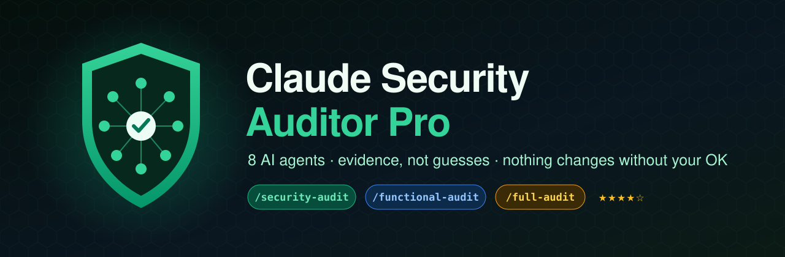
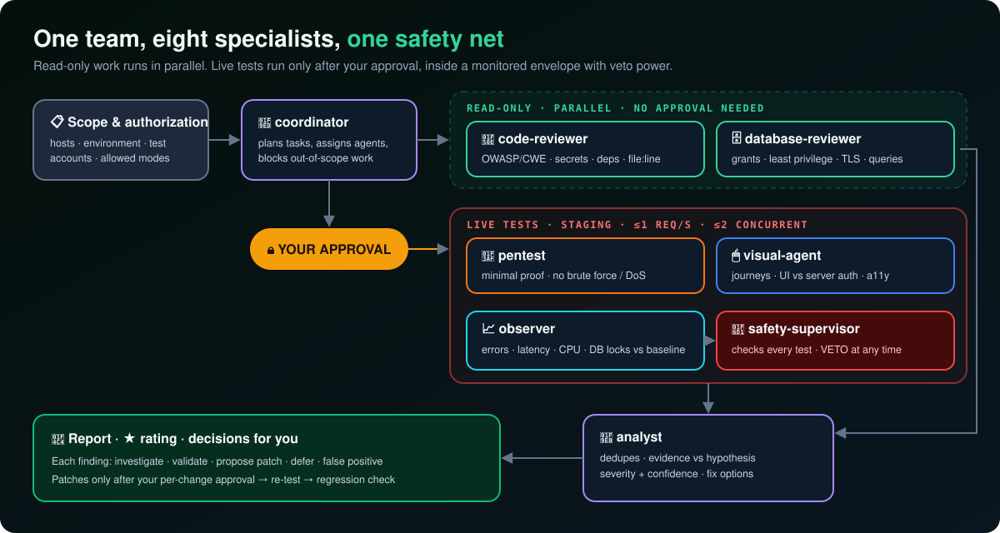
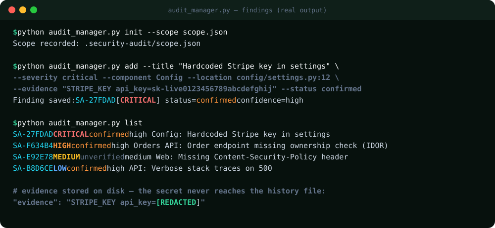
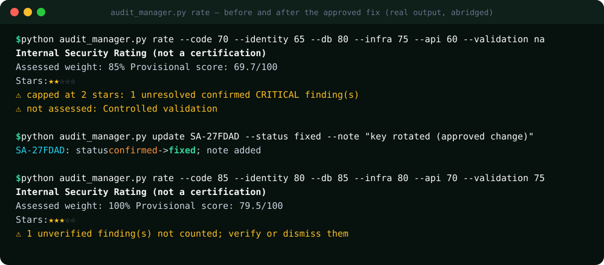

# 📘 Claude Security Auditor Pro: User Manual

<p align="center"></p>

> **English** · [Español](MANUAL.es.md) · [← Back to README](../README.md)

This manual takes you from installation to your first finished audit report.
Estimated time: **15 minutes** for setup, plus the audit itself.

**Contents**
1. [Requirements](#1-requirements)
2. [Install](#2-install)
3. [Check the installation](#3-check-the-installation)
4. [Define the scope](#4-define-the-scope-the-most-important-step)
5. [Run your first audit](#5-run-your-first-audit)
6. [Approve (or refuse) live tests](#6-approve-or-refuse-live-tests)
7. [Read the findings](#7-read-the-findings)
8. [Decide what to do with each finding](#8-decide-what-to-do-with-each-finding)
9. [The rating](#9-the-rating)
10. [The final report](#10-the-final-report)
11. [Re-audit and regressions](#11-re-audit-and-regressions)
12. [CLI reference](#12-cli-reference-audit_managerpy)
13. [Troubleshooting](#13-troubleshooting)

---

## 1. Requirements

| Needed | Why |
|---|---|
| **Claude Code** (recent version) | Runs the skills and the 8 sub-agents |
| **Python 3.8+** | Runs `audit_manager.py` (standard library only) |
| **Authorization** to test the target | Mandatory. Only your own systems or ones you are allowed to test |
| A **staging** environment + **test accounts** | Strongly recommended for live tests |

**Optional tools** (used only if they are installed; otherwise reported as coverage gaps):
Semgrep (SAST) · Gitleaks (secrets) · Trivy (dependencies/containers) · OWASP ZAP (bounded DAST) · testssl.sh (TLS) · Playwright MCP (browser for the visual agent).

---

## 2. Install

### A) Plugin (recommended)

In Claude Code:

```
/plugin marketplace add jorgevb27/claude-security-auditor-pro
/plugin install claude-security-auditor-pro@claude-security-auditor-pro
```

Restart Claude Code.

### B) Copy into a project

macOS / Linux:

```bash
git clone --depth 1 https://github.com/jorgevb27/claude-security-auditor-pro /tmp/csap
mkdir -p .claude/skills .claude/agents
cp -r /tmp/csap/skills/* .claude/skills/
cp /tmp/csap/agents/*.md .claude/agents/
echo ".security-audit/" >> .gitignore
```

Windows (PowerShell):

```powershell
git clone --depth 1 https://github.com/jorgevb27/claude-security-auditor-pro $env:TEMP\csap
New-Item -ItemType Directory -Force .claude\skills, .claude\agents | Out-Null
Copy-Item -Recurse $env:TEMP\csap\skills\* .claude\skills\
Copy-Item $env:TEMP\csap\agents\*.md .claude\agents\
Add-Content .gitignore ".security-audit/"
```

Resulting layout in your project:

```
your-project/
└── .claude/
    ├── skills/
    │   ├── security-auditor-pro/   ← core + references + scripts
    │   ├── security-audit/
    │   ├── functional-audit/
    │   └── full-audit/
    └── agents/                     ← 8 agent files
```

### C) Claude.ai

Download `claude-security-auditor-pro-skill.zip` from the [latest release](https://github.com/jorgevb27/claude-security-auditor-pro/releases/latest) →
**Settings → Capabilities → Skills → Upload skill**. Sub-agents are not available on Claude.ai, so Claude follows the same procedure on its own.

---

## 3. Check the installation

In Claude Code:

| Check | Expected |
|---|---|
| Type `/` | You see `security-audit`, `functional-audit`, `full-audit` (with the `claude-security-auditor-pro:` prefix when installed as a plugin) |
| Run `/agents` | You see the 8 agents: coordinator, code-reviewer, database-reviewer, pentest, visual-agent, observer, analyst, safety-supervisor |

---

## 4. Define the scope (the most important step)

No live test runs without a recorded scope. Claude asks for it at the start, but you can prepare it yourself.
Copy the template `skills/security-auditor-pro/references/scope.example.json` to your project as `scope.json`:

```json
{
  "project": "shop-api",
  "environment": "staging",
  "authorized_hosts": ["staging.shop.local"],
  "test_accounts": "provided securely outside repo",
  "allowed_modes": ["read-only", "bounded-functional"],
  "max_requests_per_second": 1,
  "max_concurrent_requests": 2,
  "production_writes_allowed": false
}
```

| Field | Meaning |
|---|---|
| `environment` | `staging` (recommended), `local` or `production` (read-only only, with explicit approval) |
| `authorized_hosts` | The **only** hosts any agent may send requests to |
| `test_accounts` | Where the test credentials are. **Never put passwords in this file** |
| `allowed_modes` | `read-only`, `bounded-functional`, `bounded-security` |
| `max_requests_per_second` / `max_concurrent_requests` | Hard limits for live tests |
| `production_writes_allowed` | Keep `false` |

Claude records it with `audit_manager.py init --scope scope.json` → `.security-audit/scope.json`.

---

## 5. Run your first audit

```
/security-audit        security only
/functional-audit      user journeys + UI only
/full-audit            everything + rating (recommended)
```

What happens:

<p align="center"></p>

1. **Scope check:** Claude confirms authorization, environment and hosts.
2. **Capability check:** it lists which tools are available and which are missing.
3. **Baseline:** `git status`, app health, current error and latency levels.
4. **Read-only review (parallel):** `code-reviewer` and `database-reviewer`.
5. **Live tests:** only if you approve them (next section).
6. **Analysis:** `analyst` merges, deduplicates and grades the findings.

💡 **Good first prompt:** *"Run /full-audit on this repository. Environment is staging at staging.shop.local, test users are in our password manager. Start read-only."*

---

## 6. Approve (or refuse) live tests

Before any request to a running system, Claude shows you a proposal like this:

```
LIVE TEST PROPOSAL (requires approval)
  Agent:   pentest
  Target:  https://staging.shop.local/api/orders/{id}   (in scope ✔)
  Goal:    confirm suspected IDOR in src/api/orders.py:88
  Method:  1 request as test user B for an order owned by test user A
  Limits:  1 req/s · 2 concurrent · 10 s timeout
  Safety:  observer baseline captured · safety-supervisor: APPROVED
Approve? (yes / no / modify)
```

- **yes:** the test runs with the observer watching. The safety-supervisor stops it automatically on errors, latency or unexpected writes.
- **no:** the finding stays as *unverified* and is reported as such.
- You can approve tests one by one or by group, but **never** approve production writes.

---

## 7. Read the findings

Every finding is stored in `.security-audit/history/findings.json` with secrets redacted:

<p align="center"></p>

| Severity | Meaning |
|---|---|
| **CRITICAL** | Exploitable now, with severe impact (e.g. a leaked live payment key, auth bypass) |
| **HIGH** | Serious and likely (e.g. IDOR on customer data) |
| **MEDIUM** | Real, but needs conditions or has limited impact |
| **LOW / INFO** | Hardening and good practice |

| Status | Meaning |
|---|---|
| `unverified` | Suspected, not proven yet. **Not counted** in the rating |
| `confirmed` | Proven with evidence |
| `fixed` | Fix applied and re-tested |
| `accepted` / `deferred` | You decided to live with it / do it later (still counts as open) |
| `false-positive` | Dismissed with justification |

**Confidence** (`low` / `medium` / `high`) tells you how strong the evidence is.

---

## 8. Decide what to do with each finding

For every confirmed finding, Claude offers five options:

| Option | When to use it |
|---|---|
| 🔍 **Investigate** | You need more context first |
| 🧪 **Bounded validation** | Prove it with a minimal, approved test |
| 🩹 **Propose patch** | Claude shows the diff, risk, rollback and validation plan, **and waits for your approval** |
| ⏳ **Defer** | Known, scheduled for later (recorded) |
| ❎ **False positive** | Dismiss it with a written justification |

After an approved patch, Claude runs the tests plus a security and visual regression check, compares the result with the baseline,
and marks the finding as `fixed`.

---

## 9. The rating

<p align="center"></p>

How to read it:

- Each of the 6 dimensions gets a score from 0 to 100, or `na` if it was **not tested** (it is never assumed to be perfect).
- **Assessed weight** below 80% means **no stars** ("insufficient coverage").
- An unresolved confirmed **CRITICAL** caps the rating at ★★, and an unresolved confirmed **HIGH** caps it at ★★★.
- ★★★★★ needs ≥ 95% coverage, no open critical or high findings, and evidence from the last 30 days.

In the example, the leaked key caps the project at ★★. After the approved fix (key rotated and moved to a secret manager), the same project scores ★★★.

> ⚠️ Stars are an **internal prioritization aid**. They are not a certification, and they never mean "secure".

---

## 10. The final report

```bash
python .claude/skills/security-auditor-pro/scripts/audit_manager.py report --md -o security-audit-report.md
```

Excerpt from the real output:

```markdown
# Security Audit Report - shop-api
Environment: staging
Authorized hosts: staging.shop.local

> Internal assessment. Not a third-party certification and not proof of safety.

| Severity | Total | Open |
|---|---|---|
| CRITICAL | 1 | 0 |
| HIGH | 1 | 1 |
...
| SA-27FDAD | CRITICAL | high | Config | config/settings.py:12 | STRIPE_KEY api_key=[REDACTED] | fixed |
```

Share the report, **not** the `.security-audit/` folder.

---

## 11. Re-audit and regressions

The history stays in `.security-audit/`. Run the same audit again after a release, and Claude compares the results: *fixed · new · still open · unverified*.
Each run of `rate` is appended to `ratings.json`, so you can see the trend over time.

---

## 12. CLI reference (`audit_manager.py`)

The script lives at `skills/security-auditor-pro/scripts/audit_manager.py`. Use `python3` on macOS and Linux.
It is **local only**: it never touches the network or the audit target.

| Command | Example |
|---|---|
| `init` | `audit_manager.py init --scope scope.json` |
| `add` | `audit_manager.py add --title "IDOR on orders" --severity high --component "Orders API" --location src/api/orders.py:88 --evidence "..." --confidence high --status confirmed` |
| `update` | `audit_manager.py update SA-F634B4 --status fixed --note "ownership check added"` |
| `list` | `audit_manager.py list --severity high --status confirmed` |
| `rate` | `audit_manager.py rate --code 85 --identity 80 --db 85 --infra 80 --api 70 --validation na` |
| `report` | `audit_manager.py report` · `audit_manager.py report --md -o report.md` |

Run the tests: `python -m unittest discover -s tests`.

---

## 13. Troubleshooting

| Problem | Solution |
|---|---|
| The commands don't appear after `/` | Restart Claude Code. With the plugin, look for `claude-security-auditor-pro:full-audit`. With a copy, check that the folders are in `.claude/skills/` |
| `/agents` doesn't list the 8 agents | Check that `.claude/agents/*.md` exists (copy install) or reinstall the plugin. Update Claude Code |
| "Visual coverage: NOT TESTED" | No browser tool is installed. Add Playwright MCP, or follow the manual test plan Claude generates |
| "insufficient coverage" (no stars) | Less than 80% of the weight was assessed. Add the missing dimensions (DB, infra, validation…) |
| Claude refuses a test | It is outside the scope or on the forbidden list. Update `scope.json` if the host really is authorized |
| `python3` not found (Windows) | Use `python` |

---

**Responsible use:** only test systems you own or are explicitly authorized to test. Respect the policy in
[POLICY.md](../skills/security-auditor-pro/references/POLICY.md).
