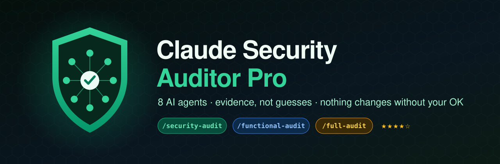
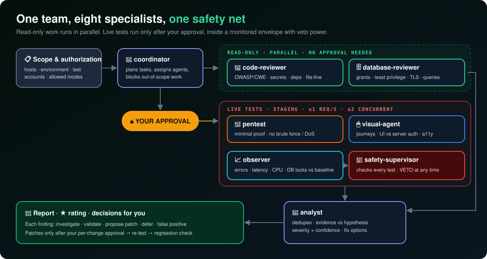
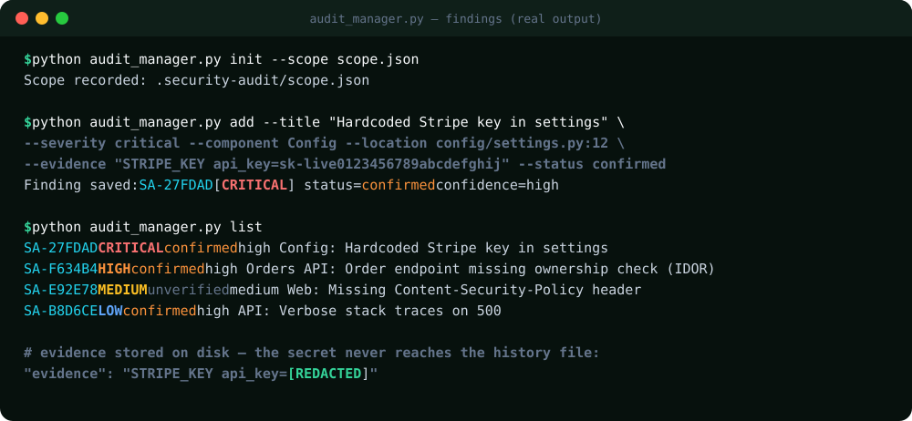
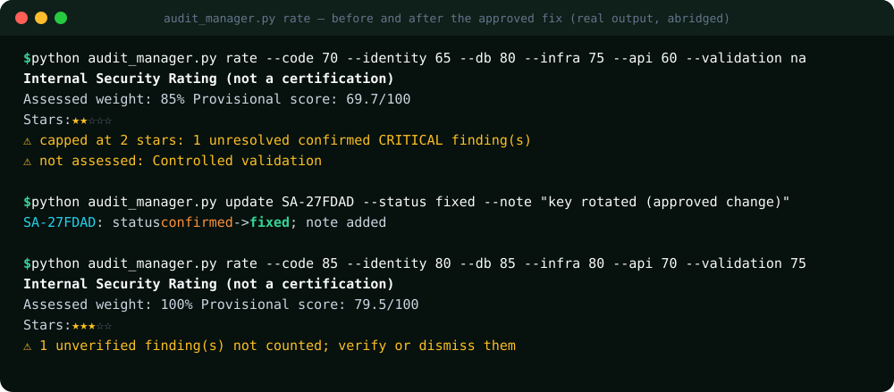

# 📗 Claude Security Auditor Pro: Manual de uso

<p align="center"></p>

> [English](MANUAL.en.md) · **Español** · [← Volver al README](../README.es.md)

Este manual te lleva desde la instalación hasta tu primer informe de auditoría terminado.
Tiempo estimado: **15 minutos** de configuración, más lo que dure la auditoría.

**Contenido**
1. [Requisitos](#1-requisitos)
2. [Instalación](#2-instalación)
3. [Verificar la instalación](#3-verificar-la-instalación)
4. [Definir el alcance](#4-definir-el-alcance-el-paso-más-importante)
5. [Tu primera auditoría](#5-tu-primera-auditoría)
6. [Aprobar (o rechazar) pruebas en vivo](#6-aprobar-o-rechazar-pruebas-en-vivo)
7. [Leer los hallazgos](#7-leer-los-hallazgos)
8. [Decidir qué hacer con cada hallazgo](#8-decidir-qué-hacer-con-cada-hallazgo)
9. [La calificación](#9-la-calificación)
10. [El informe final](#10-el-informe-final)
11. [Reauditoría y regresiones](#11-reauditoría-y-regresiones)
12. [Referencia del CLI](#12-referencia-del-cli-audit_managerpy)
13. [Solución de problemas](#13-solución-de-problemas)

---

## 1. Requisitos

| Qué necesitás | Para qué |
|---|---|
| **Claude Code** (versión reciente) | Ejecuta las skills y los 8 subagentes |
| **Python 3.8+** | Ejecuta `audit_manager.py` (solo usa la librería estándar) |
| **Autorización** para probar el sistema | Obligatoria. Solo sistemas tuyos o que te autorizaron a probar |
| Un entorno de **staging** y **cuentas de prueba** | Muy recomendados para las pruebas en vivo |

**Herramientas opcionales** (se usan solo si están instaladas; si no, se informan como huecos de cobertura):
Semgrep (SAST) · Gitleaks (secretos) · Trivy (dependencias y contenedores) · OWASP ZAP (DAST acotado) · testssl.sh (TLS) · Playwright MCP (navegador para el agente visual).

---

## 2. Instalación

### A) Plugin (recomendada)

En Claude Code:

```
/plugin marketplace add jorgevb27/claude-security-auditor-pro
/plugin install claude-security-auditor-pro@claude-security-auditor-pro
```

Reiniciá Claude Code.

### B) Copiar a un proyecto

macOS / Linux:

```bash
git clone --depth 1 https://github.com/jorgevb27/claude-security-auditor-pro /tmp/csap
mkdir -p .claude/skills .claude/agents
cp -r /tmp/csap/skills/* .claude/skills/
cp /tmp/csap/agents/*.md .claude/agents/
echo ".security-audit/" >> .gitignore
```

Windows (PowerShell):

```powershell
git clone --depth 1 https://github.com/jorgevb27/claude-security-auditor-pro $env:TEMP\csap
New-Item -ItemType Directory -Force .claude\skills, .claude\agents | Out-Null
Copy-Item -Recurse $env:TEMP\csap\skills\* .claude\skills\
Copy-Item $env:TEMP\csap\agents\*.md .claude\agents\
Add-Content .gitignore ".security-audit/"
```

Así queda tu proyecto:

```
tu-proyecto/
└── .claude/
    ├── skills/
    │   ├── security-auditor-pro/   ← núcleo + referencias + scripts
    │   ├── security-audit/
    │   ├── functional-audit/
    │   └── full-audit/
    └── agents/                     ← los 8 agentes
```

### C) Claude.ai

Descargá `claude-security-auditor-pro-skill.zip` de la [última release](https://github.com/jorgevb27/claude-security-auditor-pro/releases/latest) →
**Configuración → Capacidades → Skills → Subir skill**. En Claude.ai no hay subagentes, así que Claude sigue el mismo procedimiento por su cuenta.

---

## 3. Verificar la instalación

En Claude Code:

| Prueba | Resultado esperado |
|---|---|
| Escribí `/` | Aparecen `security-audit`, `functional-audit` y `full-audit` (con el prefijo `claude-security-auditor-pro:` si lo instalaste como plugin) |
| Ejecutá `/agents` | Aparecen los 8 agentes: coordinator, code-reviewer, database-reviewer, pentest, visual-agent, observer, analyst y safety-supervisor |

---

## 4. Definir el alcance (el paso más importante)

Sin un alcance registrado no corre ninguna prueba en vivo. Claude te lo pide al empezar, pero también podés prepararlo vos.
Copiá la plantilla `skills/security-auditor-pro/references/scope.example.json` a tu proyecto con el nombre `scope.json`:

```json
{
  "project": "shop-api",
  "environment": "staging",
  "authorized_hosts": ["staging.shop.local"],
  "test_accounts": "provided securely outside repo",
  "allowed_modes": ["read-only", "bounded-functional"],
  "max_requests_per_second": 1,
  "max_concurrent_requests": 2,
  "production_writes_allowed": false
}
```

| Campo | Significado |
|---|---|
| `environment` | `staging` (recomendado), `local` o `production` (solo lectura y con aprobación explícita) |
| `authorized_hosts` | Los **únicos** hosts a los que un agente puede enviar requests |
| `test_accounts` | Dónde están las credenciales de prueba. **Nunca pongas contraseñas en este archivo** |
| `allowed_modes` | `read-only`, `bounded-functional`, `bounded-security` |
| `max_requests_per_second` / `max_concurrent_requests` | Límites estrictos para las pruebas en vivo |
| `production_writes_allowed` | Dejalo en `false` |

Claude lo registra con `audit_manager.py init --scope scope.json` → `.security-audit/scope.json`.

---

## 5. Tu primera auditoría

```
/security-audit        solo seguridad
/functional-audit      solo recorridos de usuario e interfaz
/full-audit            todo + calificación (recomendado)
```

Qué pasa durante la auditoría:

<p align="center"></p>

1. **Alcance:** Claude confirma la autorización, el entorno y los hosts.
2. **Herramientas:** te dice cuáles hay disponibles y cuáles faltan.
3. **Línea base:** `git status`, salud de la aplicación, nivel actual de errores y latencia.
4. **Revisión de solo lectura (en paralelo):** `code-reviewer` y `database-reviewer`.
5. **Pruebas en vivo:** solo si las aprobás (siguiente sección).
6. **Análisis:** `analyst` une, deduplica y califica los hallazgos.

💡 **Un buen primer pedido:** *"Ejecutá /full-audit en este repositorio. El entorno es staging en staging.shop.local y los usuarios de prueba están en nuestro gestor de contraseñas. Empezá en modo solo lectura."*

---

## 6. Aprobar (o rechazar) pruebas en vivo

Antes de enviar cualquier request a un sistema en funcionamiento, Claude te muestra una propuesta como esta:

```
LIVE TEST PROPOSAL (requires approval)
  Agent:   pentest
  Target:  https://staging.shop.local/api/orders/{id}   (in scope ✔)
  Goal:    confirm suspected IDOR in src/api/orders.py:88
  Method:  1 request as test user B for an order owned by test user A
  Limits:  1 req/s · 2 concurrent · 10 s timeout
  Safety:  observer baseline captured · safety-supervisor: APPROVED
Approve? (yes / no / modify)
```

- **Sí:** la prueba corre con el observador vigilando. El supervisor la frena automáticamente si hay errores, latencia alta o escrituras inesperadas.
- **No:** el hallazgo queda como *unverified* y se informa así.
- Podés aprobar las pruebas de a una o por grupo, pero **nunca** apruebes escrituras en producción.

---

## 7. Leer los hallazgos

Cada hallazgo se guarda en `.security-audit/history/findings.json`, con los secretos enmascarados:

<p align="center"></p>

| Severidad | Significado |
|---|---|
| **CRITICAL** | Explotable ahora y con impacto grave (por ejemplo, una clave de pagos real filtrada o una forma de saltear el login) |
| **HIGH** | Grave y probable (por ejemplo, un IDOR sobre datos de clientes) |
| **MEDIUM** | Real, pero requiere condiciones o tiene impacto limitado |
| **LOW / INFO** | Endurecimiento y buenas prácticas |

| Estado | Significado |
|---|---|
| `unverified` | Sospechado, todavía sin probar. **No cuenta** para la calificación |
| `confirmed` | Probado con evidencia |
| `fixed` | Arreglado y vuelto a probar |
| `accepted` / `deferred` | Decidiste convivir con él / dejarlo para después (sigue contando como abierto) |
| `false-positive` | Descartado con justificación |

La **confianza** (`low` / `medium` / `high`) indica qué tan sólida es la evidencia.

---

## 8. Decidir qué hacer con cada hallazgo

Para cada hallazgo confirmado, Claude te ofrece cinco opciones:

| Opción | Cuándo usarla |
|---|---|
| 🔍 **Investigar** | Necesitás más contexto antes de decidir |
| 🧪 **Validación acotada** | Querés probarlo con un test mínimo y aprobado |
| 🩹 **Proponer parche** | Claude te muestra el diff, el riesgo, cómo revertirlo y cómo validarlo, **y espera tu aprobación** |
| ⏳ **Posponer** | Ya lo conocés y lo vas a resolver más adelante (queda registrado) |
| ❎ **Falso positivo** | Lo descartás con una justificación escrita |

Después de un parche aprobado, Claude corre los tests y un control de regresiones de seguridad y visuales, compara el resultado con la línea base
y marca el hallazgo como `fixed`.

---

## 9. La calificación

<p align="center"></p>

Cómo leerla:

- Cada una de las 6 dimensiones recibe un puntaje de 0 a 100, o `na` si **no se probó** (nunca se asume que está perfecta).
- Si el **peso evaluado** es menor al 80 %, no hay estrellas ("insufficient coverage").
- Un **CRÍTICO** confirmado y sin resolver limita la calificación a ★★, y un **ALTO** confirmado y sin resolver, a ★★★.
- Para ★★★★★ hace falta ≥ 95 % de cobertura, ningún crítico ni alto abierto, y evidencia de los últimos 30 días.

En el ejemplo, la clave filtrada deja el proyecto en ★★. Después del arreglo aprobado (clave rotada y movida a un gestor de secretos), el mismo proyecto llega a ★★★.

> ⚠️ Las estrellas son una **ayuda interna para priorizar**. No son una certificación y nunca significan "seguro".

---

## 10. El informe final

```bash
python .claude/skills/security-auditor-pro/scripts/audit_manager.py report --md -o security-audit-report.md
```

Fragmento de la salida real:

```markdown
# Security Audit Report - shop-api
Environment: staging
Authorized hosts: staging.shop.local

> Internal assessment. Not a third-party certification and not proof of safety.

| Severity | Total | Open |
|---|---|---|
| CRITICAL | 1 | 0 |
| HIGH | 1 | 1 |
...
| SA-27FDAD | CRITICAL | high | Config | config/settings.py:12 | STRIPE_KEY api_key=[REDACTED] | fixed |
```

Compartí el informe, **no** la carpeta `.security-audit/`.

---

## 11. Reauditoría y regresiones

El historial queda en `.security-audit/`. Si volvés a correr la misma auditoría después de una entrega, Claude compara los resultados: *arreglados · nuevos · siguen abiertos · sin verificar*.
Cada ejecución de `rate` se agrega a `ratings.json`, así podés ver la evolución en el tiempo.

---

## 12. Referencia del CLI (`audit_manager.py`)

El script está en `skills/security-auditor-pro/scripts/audit_manager.py`. En macOS y Linux usá `python3`.
Es **solo local**: nunca toca la red ni el sistema auditado.

| Comando | Ejemplo |
|---|---|
| `init` | `audit_manager.py init --scope scope.json` |
| `add` | `audit_manager.py add --title "IDOR en pedidos" --severity high --component "Orders API" --location src/api/orders.py:88 --evidence "..." --confidence high --status confirmed` |
| `update` | `audit_manager.py update SA-F634B4 --status fixed --note "se agregó control de dueño"` |
| `list` | `audit_manager.py list --severity high --status confirmed` |
| `rate` | `audit_manager.py rate --code 85 --identity 80 --db 85 --infra 80 --api 70 --validation na` |
| `report` | `audit_manager.py report` · `audit_manager.py report --md -o informe.md` |

Para correr los tests: `python -m unittest discover -s tests`.

---

## 13. Solución de problemas

| Problema | Solución |
|---|---|
| No aparecen los comandos al escribir `/` | Reiniciá Claude Code. Con el plugin, buscá `claude-security-auditor-pro:full-audit`. Si copiaste la carpeta, revisá que esté en `.claude/skills/` |
| `/agents` no muestra los 8 agentes | Revisá que exista `.claude/agents/*.md` (instalación por copia) o reinstalá el plugin. Actualizá Claude Code |
| "Visual coverage: NOT TESTED" | No hay ninguna herramienta de navegador instalada. Agregá Playwright MCP o seguí el plan de pruebas manual que te genera Claude |
| "insufficient coverage" (sin estrellas) | Se evaluó menos del 80 % del peso. Agregá las dimensiones que faltan (base de datos, infraestructura, validación…) |
| Claude rechaza una prueba | Está fuera del alcance o en la lista prohibida. Actualizá `scope.json` si el host realmente está autorizado |
| No encuentra `python3` (Windows) | Usá `python` |

---

**Uso responsable:** probá solo sistemas que sean tuyos o que tengas autorización explícita para probar. Respetá la política de
[POLICY.md](../skills/security-auditor-pro/references/POLICY.md).
